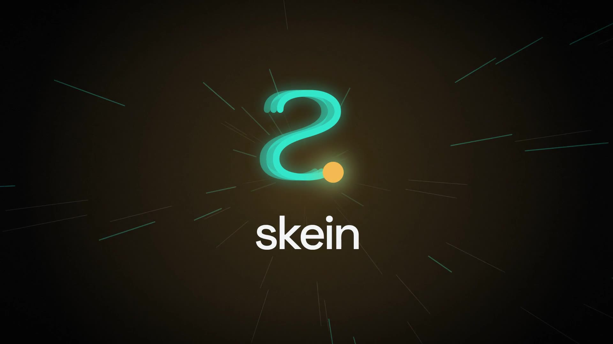
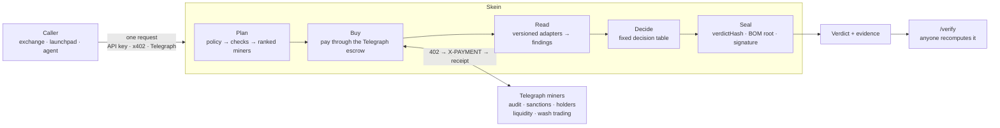

<div align="center">


# Skein

### One request. Every thread.

**The listing verdict for tokens: independent intelligence bought on Telegraph, fused by fixed rules, and sealed with a receipt for every input.**

[](https://github.com/linoxbt/skein/actions/workflows/ci.yml)
[](https://github.com/linoxbt/skein/actions/workflows/uptime.yml)
[](https://www.npmjs.com/package/@skeinlabs/sdk)
[](https://www.npmjs.com/package/@skeinlabs/mcp)
[](https://devnode.telegraphprotocol.com/api/miners/5137)
[](LICENSE)

[**Website**](https://skeinlabs.site) ·
[**Demo film**](docs/demo/skein-motion.mp4) ·
[**Tutorial**](https://skeinlabs.site/tutorial) ·
[**API reference**](https://api.skeinlabs.site/v1/openapi.json) ·
[**Skein Desk**](https://desk.skeinlabs.site) ·
[**Reviewer guide**](docs/REVIEWER_GUIDE.md)

<a href="docs/demo/skein-motion.mp4"></a>

<sub>▶ <a href="docs/demo/skein-motion.mp4">Watch the 4-minute film</a>. Two live verdicts, a listing approved and a sanctioned address rejected, each recomputed on /verify.</sub>

</div>

---

## Contents

- [Why Skein](#why-skein)
- [What a verdict looks like](#what-a-verdict-looks-like)
- [How it works](#how-it-works)
- [Quick start](#quick-start)
- [What runs on Skein](#what-runs-on-skein)
- [Trust and verification](#trust-and-verification)
- [Policies](#policies)
- [API reference](#api-reference)
- [Results](#results)
- [Architecture](#architecture)
- [Development](#development)
- [Deployment and operations](#deployment-and-operations)
- [Security model](#security-model)
- [Limitations and roadmap](#limitations-and-roadmap)
- [Documentation](#documentation)
- [Disclosures and license](#disclosures-and-license)

---

## Why Skein

Thousands of tokens launch every day, and most are built to take money:
honeypots, mintable supplies, wash-traded volume, sanctioned deployers,
liquidity that disappears. Anyone who lists or trades tokens has to answer
one question, quickly and defensibly: **is this token fit to list?**

Today that answer is stitched together by hand. A team buys five vendors,
opens five dashboards and spends hours on triage, and is left with a
judgement nobody can reconstruct when it goes wrong.

Skein turns that into **one request** and **one auditable decision**:

| | Without Skein | With Skein |
|---|---|---|
| **Inputs** | Five vendor contracts and integrations | One call, paying per use. Skein buys each check from ranked Telegraph miners |
| **Output** | Scores to interpret | A verdict: `APPROVE`, `REJECT`, `ESCALATE` or `ABSTAIN`, with reasons and open risks |
| **Speed** | Hours of analyst triage | About 6 seconds; the checks run in parallel |
| **Audit** | Screenshots and memory | A signed verdict and a bill of materials with a receipt for every purchase |
| **Trust** | "The vendor said so" | Anyone can recompute the verdict from the raw answers it paid for |
| **Cost** | Fixed subscriptions | 0.25 USDC a verdict, under hard spend caps |

---

## What a verdict looks like

A real verdict, `vrd_mw8dfz384v6a6v094n03`, bought live through Telegraph
testnet for Aerodrome (AERO) on Base. It is trimmed here; open
[the verdict page](https://skeinlabs.site/v/vrd_mw8dfz384v6a6v094n03) or
[verify it](https://skeinlabs.site/verify?id=vrd_mw8dfz384v6a6v094n03).

```jsonc
{
  "id": "vrd_mw8dfz384v6a6v094n03",
  "verdict": "APPROVE",
  "summary": "Approved: contract_audit WARN is_mintable.",
  "riskBps": 1886,                      // 0–10,000
  "confidenceBps": 6089,
  "coverage": 0.84,                     // weighted share of the policy's checks that answered
  "reasons":   [{ "code": "CONTRACT_AUDIT_WARN", "check": "contract_audit", "detail": "contract_audit WARN is_mintable" }],
  "openRisks": ["social_bots UNAVAILABLE", "code_review UNAVAILABLE"],
  "subject":   { "chainId": 8453, "token": "0x940181a94a35a4569e4529a3cdfb74e38fd98631" },
  "cost":      { "upstreamUsdc": 0.05, "priceUsdc": 0.25, "pricingRule": "standard", "currency": "USDC" },
  "policy":    { "id": "dex-list", "version": "0.2.0", "sha256": "26038dda…" },
  "engineVersion": "0.2.0",
  "verdictHash": "0x88f851ac…",         // keccak256 over the canonical decision record
  "bom": { "root": "0x2b024c6d…", "items": [ /* 5 purchases: miner, price, receipt hash, signal hash */ ] },
  "attestation": { "scheme": "eip191", "signer": "0x07Dee329…5639309", "signature": "0x…" },
  "durationMs": 5817
}
```

---

## How it works



1. **Plan.** The [policy](#policies) names the checks a verdict needs, and
   Skein picks a ranked, allowlisted miner for each one from the live Telegraph
   catalogue.
2. **Buy.** Every check is paid through the Telegraph escrow in USDC, machine
   to machine. Purchases run in parallel against one deadline per verdict.
   They stay inside a per-call ceiling, a per-verdict budget and a daily cap,
   which are enforced atomically in Postgres.
3. **Read.** Each paid answer goes through an immutable, versioned adapter,
   which turns it into a finding (`PASS`, `WARN`, `FAIL` or `UNAVAILABLE`) and
   keeps the raw answer and its receipt.
4. **Decide.** A pure decision table runs in a fixed order. The first row that
   matches decides:

   | # | Condition | Verdict |
   |---|---|---|
   | 1 | A blocker hits (a honeypot, or a deployer on the OFAC SDN list) | `REJECT` |
   | 2 | A required check has no real answer | `ABSTAIN`, naming the check |
   | 3 | Coverage is below the policy minimum | `ABSTAIN` |
   | 4 | `riskBps` ≥ the reject threshold | `REJECT` |
   | 5 | Two checks contradict each other (audit PASS, wash trading FAIL) | `ESCALATE` |
   | 6 | A required check is at `FAIL` | `ESCALATE` |
   | 7 | `riskBps` < the approve threshold and confidence ≥ the minimum | `APPROVE` |
   | 8 | Anything else | `ESCALATE` |

5. **Seal.** The decision is hashed (`verdictHash`). The receipts are
   Merkle-rooted into a bill of materials (`bom.root`). The verdict is signed
   (EIP-191) and stored append-only.

The same findings under the same policy version always give the same verdict
and the same hash. That property is tested with 20,000 generated cases on
every CI run.

---

## Quick start

There are five ways in. Pick the one that fits your stack.

**Free quote: what a verdict would buy and cost**

```sh
curl "https://api.skeinlabs.site/v1/quote?chain=8453&token=0x4200000000000000000000000000000000000006"
```

<details open>
<summary><b>TypeScript SDK</b></summary>

```sh
npm install @skeinlabs/sdk
```

```ts
import { Skein } from "@skeinlabs/sdk";

const skein = new Skein({
  apiUrl: "https://api.skeinlabs.site",
  payer: { kind: "apiKey", key: process.env.SKEIN_API_KEY! },
  maxUsdcPerCall: 0.3,                                  // client-side spend cap
});

const v = await skein.verdict({ subject: { chainId: 8453, token: "0x…" } });
if (v.verdict !== "APPROVE") holdForReview(v.reasons, v.openRisks);
```

The SDK also offers `quote()`, `verify()`, `stream()` (live events),
`submit()`/`wait()`, typed errors, retries and webhooks. It can pay with a
partner key or directly through Telegraph (`{ kind: "telegraph", client }`).
A runnable app is in [`examples/listing-gate`](examples/listing-gate).

</details>

<details>
<summary><b>MCP server (Claude, Cursor and other MCP clients)</b></summary>

```sh
claude mcp add skein --env SKEIN_API_KEY=sk_part_… -- npx -y @skeinlabs/mcp
```

The server provides three tools: `skein_verdict`, `skein_quote` and
`skein_verify`. Then ask: *"Is 0x… on Base fit to list?"*

</details>

<details>
<summary><b>x402: pay per verdict, no account</b></summary>

`POST /v1/verdicts` without a key answers `402` with standard x402 terms:
0.25 USDC on Base Sepolia. Any x402 client can pay. The payment is verified
before anything is bought, and it settles only once a verdict is sealed.

```ts
import { wrapFetchWithPayment } from "x402-fetch";
import { privateKeyToAccount } from "viem/accounts";

// x402-fetch's default ceiling is 0.10 USDC; a verdict is 0.25.
const pay = wrapFetchWithPayment(fetch, privateKeyToAccount(process.env.PAYER_KEY as `0x${string}`), 250_000n);
const res = await pay("https://api.skeinlabs.site/v1/verdicts", {
  method: "POST",
  headers: { "content-type": "application/json" },
  body: JSON.stringify({ subject: { chainId: 8453, token: "0x…" } }),
});
// 200 with the signed verdict; X-PAYMENT-RESPONSE carries the settlement transaction.
```

</details>

<details>
<summary><b>Telegraph: buy from the Skein miner</b></summary>

Skein is a registered, active Telegraph miner: registration `5137`,
catalogue id `845301`, slug `skein-listing-verdict`, intent
`FRAUD_RISK_GENERAL`, 0.25 USDC an answer. Any Telegraph agent can buy a
verdict with one paid ask, with no account and no key:

```
POST /engine/v1/ask/845301
```

</details>

<details>
<summary><b>REST</b></summary>

```sh
curl -X POST https://api.skeinlabs.site/v1/verdicts \
  -H "authorization: Bearer $SKEIN_API_KEY" \
  -H "idempotency-key: listing-review-42" \
  -H "content-type: application/json" \
  -d '{"subject":{"chainId":8453,"token":"0x4200000000000000000000000000000000000006"},"policy":"dex-list@0.2.0"}'
```

Add `"mode":"async"` to get `202` at once, then follow
`/v1/verdicts/{id}/events` (SSE) or register a webhook.

</details>

**Partner keys are free during the hackathon.**
[Request one](https://github.com/linoxbt/skein/issues/new?template=partner-key.yml),
or start with the [tutorial](https://skeinlabs.site/tutorial).

---

## What runs on Skein

| | | |
|---|---|---|
| **[Web console](https://skeinlabs.site)** | Run a verdict and watch each paid check land live in the Exploded View. Verdict pages have Findings, Evidence, Cost and JSON tabs. Also: `/verify`, `/ledger`, `/status`, `/policies`, docs and the tutorial. | Next.js 15 · Netlify |
| **[Skein Desk](https://desk.skeinlabs.site)** | A listing queue for a fictional exchange, run by an agent. Every application buys a Skein verdict and is shortlisted, declined or sent to an analyst, with no human in the loop. Mission 01 (Exchange). | Next.js · Netlify |
| **[Skein Sniper](https://sniper-production-bea6.up.railway.app)** | Watches every new pool on Base and buys a verdict before any trade: no `APPROVE`, no trade. Trades are paper; the verdicts are bought live. Mission 14 (Web3 Native and DeFi). | Node · Railway |
| **Skein miner** | Sells the verdict back to the network as Telegraph miner 5137. | Telegraph testnet |

---

## Trust and verification

Skein is built so that you **don't have to trust it**.

- **Every input has a receipt.** The bill of materials lists each purchase:
  miner, price, latency, receipt hash, and the signal hash on the Telegraph
  node.
- **Every verdict is deterministic.** `verdictHash` is keccak256 over
  canonical JSON of the engine version, the policy, the subject, the sorted
  findings and the decision. The same inputs always give the same hash.
- **Every verdict is signed.** An EIP-191 attestation by a published key,
  shown at `/v1/status`.
- **Every verdict can be recomputed.**
  [`/verify`](https://skeinlabs.site/verify) (or `POST /v1/verify`) does five
  things:
  - re-reads each raw paid answer with the adapter version recorded with it;
  - reruns the policy;
  - rebuilds the Merkle root from the receipts;
  - checks the engine version;
  - recovers the signature.

  Offline: `pnpm repro <verdict.json>`.
- **Evidence is append-only.** Purchases, findings and verdicts are never
  edited after the fact. Adapters and policies are immutable once published,
  and every superseded version is kept so old verdicts still replay.

---

## Policies

Policies are versioned YAML files, locked by hash in
`packages/policies/policies.lock.json`. A published version never changes.

| Policy | For | Required checks |
|---|---|---|
| `dex-list@0.2.0` *(default)* | DEX token lists, launchpads, wallets: badge or hide a token | contract audit, sanctions, liquidity depth, holder count |
| `agent-pretrade@0.2.0` | Trading agents: no `APPROVE`, no trade; traps are hard blockers | contract audit, sanctions, liquidity depth, holder count |
| `cex-standard@0.1.0` | Centralised-exchange listing review (draft) | adds holder concentration and wash trading |

`cex-standard` needs a holder-concentration intent that no Telegraph miner
offers yet, so it refuses with `503 UPSTREAM_UNAVAILABLE` rather than give a
weaker answer.

---

## API reference

Base URL: `https://api.skeinlabs.site`. The full OpenAPI 3.1 document is at
[`/v1/openapi.json`](https://api.skeinlabs.site/v1/openapi.json).

| Method | Path | |
|---|---|---|
| `POST` | `/v1/verdicts` | Buy a verdict: sync, or async with SSE and webhooks. Idempotent per `Idempotency-Key` |
| `GET` | `/v1/verdicts/{id}` | A verdict, or the state of a run |
| `GET` | `/v1/verdicts/{id}/bom` | The bill of materials: every purchase, its miner, receipt and cost |
| `GET` | `/v1/verdicts/{id}/events` | Server-sent events: plan, purchases, findings, decision, done |
| `POST` | `/v1/verify` | Recompute a verdict from its raw answers |
| `GET` | `/v1/quote` | What a verdict would buy and cost; free |
| `GET` | `/v1/policies[/{ref}]` | Published policies and their file hashes |
| `GET` | `/v1/status` | Network, payer escrow, caps, attester, and each check's miners, latency and error rate |
| `GET` | `/v1/ledger` | The public spend ledger |
| `GET` `POST` `DELETE` | `/v1/webhooks` | The caller's signed webhook (`verdict.completed`, `verdict.refused`) |
| `POST` | `/miner/verdict` | Telegraph's miner endpoint, called only by the network's dispatcher |

Every error has the shape `{ error: { code, message, requestId } }`, and
every response carries `X-Request-Id`. Served verdicts carry
`X-Skein-Verdict-Hash`, `X-Skein-Bom-Root` and `X-Skein-Attestation`.

**Webhooks** (SDK 0.3.1+):

```ts
const { secret } = await skein.setWebhook("https://you.example/skein");   // shown once: store it
import { verifyWebhook } from "@skeinlabs/sdk/webhooks";
if (!(await verifyWebhook(rawBody, req.headers, secret))) return res.status(401).end();   // pass every header
```

Deliveries carry `X-Skein-Timestamp` (unix seconds) and
`X-Skein-Signature: sha256=…`, an HMAC-SHA256 of `<timestamp>.<raw body>`;
`verifyWebhook` refuses a delivery older than 5 minutes, so a captured one
cannot be replayed. The event is `verdict.completed` (or `verdict.refused`).
Secrets are encrypted at rest. A webhook URL must be public https. It is re-checked before every delivery,
and redirects are never followed.

---

## Results

**Live on Telegraph testnet.** The numbers move every day, so they are not
copied here: [/ledger](https://skeinlabs.site/ledger) and
[`/v1/ledger`](https://api.skeinlabs.site/v1/ledger) show verdicts served by
outcome, upstream receipts, miners paid and upstream spend. On Nov 12, 2026
they read 353 verdicts (5 APPROVE, 51 REJECT, 87 ESCALATE, 210 ABSTAIN), 1,017
receipts from 10 miners and 10.56 USDC spent. Most ABSTAINs come from Skein
Sniper's fresh launches, where a required check has nothing to read yet.

**Held-out benchmark** ([eval/REPORT-holdout.md](eval/REPORT-holdout.md)).
Twenty tokens (13 long-listed, 7 documented scams) were run once, after the
rules were frozen. Intervals are 95% Wilson intervals; with 7 scams they are
wide, and the table should be read that way:

| | Skein | Required checks only ("cheapest") | Weighted average | Best single check |
|---|:---:|:---:|:---:|:---:|
| Scams approved (of 7) | 0 (0–35%) | 0 (0–35%) | 1 | 1 |
| Scams rejected (of 7) | 3 | 3 | 6 | 5 |
| Good tokens approved (of 13) | 4 | 7 | 10 | 3 |
| Good tokens rejected (of 13) | 0 | 0 | 0 | 3 |
| Abstained (of 20) | 8 | 8 | 0 | 3 |
| Cost per verdict | $0.049 | $0.038 | $0.049 | $0.010 |

What this does and does not show:
- Skein's rules never approved a scam or rejected a good token here, but 0 of
  7 is consistent with a true false-approve rate of up to about a third.
- **The same rules on the required checks alone did as well for less**: the
  same scams stopped, more good tokens approved, 22% cheaper. On this sample
  the optional checks added escalations, not catches. The tune split
  ([eval/REPORT-tune.md](eval/REPORT-tune.md)) shows the same pattern.
- The weighted average rejects more scams but also approves one, which is the
  error a listing desk cannot afford.
- The tokens are judged on their current state, not before their events; method
  and caveats are in [eval/FINDINGS-holdout.md](eval/FINDINGS-holdout.md).

**Skein Sniper.** Live figures are at
[`/feed.json`](https://sniper-production-bea6.up.railway.app/feed.json)
(`allTime`, and `book.medianSkippedChange`). By Nov 12 it had checked 320
launches and approved none, so it has never made its paper buy.
`medianSkippedChange` moves with the market (−99.99% on Nov 8, −2.3% on
Nov 11) and is not a measure of foresight.

A backtest of the 106 answered verdicts is in
[eval/FINDINGS-sniper.md](eval/FINDINGS-sniper.md). It found:
- **The contract audit is the real signal.** 22 of 23 launches with an audit
  WARN went to zero, against 8 of 69 with a PASS.
- **Liquidity and holders are not.** Launches that passed every check still
  had their liquidity pulled.

From Nov 11 the sniper runs `agent-pretrade@0.3.0`, chosen on that backtest
(in-sample). Approving fresh launches would need a liquidity-lock signal that
no Telegraph intent offers yet.

**Who has used it.** Kept apart, as the hackathon rules ask:
- **Testnet usage (live, real payments in test USDC):** every verdict on
  [/ledger](https://skeinlabs.site/ledger) was bought on the Telegraph testnet,
  with receipts.
- **Internal consumers (the same team):** Skein Desk and Skein Sniper buy
  verdicts as customers would, and the evaluation runs in `eval/`. Their
  purchases are ours, not outside demand.
- **Outside users:** none confirmed yet. Partner keys are issued on request
  (README, Quick start); any outside integration will be listed here with its
  permission.

**Prospective benchmark** (out of sample,
[`data/prospective`](https://github.com/linoxbt/skein/blob/data/prospective/REPORT.md),
updated daily). Each launch is labelled by what happened in the 72 hours after
its verdict. The Nov 12 run labelled 80 launches: **49 bad, 31 ambiguous and
none good**. Skein approved none of the 80, so its 0% false-approve rate there
says nothing about its judgment: a rule that never approves scores the same.
What the run does measure is how often Skein stops a bad launch outright: REJECT
recall 38.8% (95% CI 25.5–52.8%) at 82.6% precision, against 40.8% for the
weighted average, which also approved 16% of the bad launches. The first runs
scored `agent-pretrade@0.2.0` verdicts from before the 0.3.0 rules were chosen;
the policy that sealed each verdict is recorded in its run file.

---

## Architecture

```
            ┌────────────────────────── consumers ──────────────────────────┐
            │  web (Next.js)       Desk (Next.js)       Sniper       MCP / SDK │
            └──────────────┬────────────────────┬──────────────────┬───────┘
                           │ HTTPS · x402        │ @skeinlabs/sdk    │
                           ▼                     ▼                  ▼
   Telegraph dispatcher ─► API (Hono, 2 replicas on Railway) ─ /v1/* and /miner/verdict
                           │  VerdictService: claim run → plan → buy → decide → seal
                           │        pipeline ────┬──► Telegraph node (escrow 402 → X-PAYMENT → receipt)
                           │        engine (pure)│      └─ upstream miners (audit, sanctions, liquidity, …)
                           ▼                     ▼
                     Postgres: verdict_runs · purchases · findings · verdicts · events · spend_holds
                               rate_limits · flights · kv · error_log      (nightly pg_dump → bucket)
```

```
packages/
  engine/      planner, adapters, scoring, reconcile, decide, seal, reproduce; pure, no network calls
  policies/    versioned YAML policies, immutable once published (policies.lock.json)
  telegraph/   network config, escrow-paying client, intent map, miner allowlist, fake node for tests
  pipeline/    request builders, purchaser, runVerdict(); the verdict and repro CLIs
  db/          Drizzle schema and migrations (append-only evidence, row-level security)
  sdk/         @skeinlabs/sdk: typed client, retries, spend cap, webhooks; API key or Telegraph rail
  mcp/         @skeinlabs/mcp: stdio MCP server (skein_verdict, skein_quote, skein_verify)
  errors/      Sentry-compatible error reporter, no dependencies
  alerts/      alerts to ntfy, Slack or Discord, deduplicated across processes in Postgres
  ui/          design tokens and shared components (web and Desk)
apps/
  api/         Hono API, miner endpoint, x402, shared rate limits; Dockerfile
  web/         the web console; Netlify
  desk/        Skein Desk, the agent-run listing queue; Netlify
  sniper/      Skein Sniper, the Mission 14 agent; Dockerfile
  backup/      nightly pg_dump to a private bucket (Railway cron)
  probe/       checks everything every 10 minutes and pushes alerts (Railway cron)
miner/         miner YAML, validation, escrow and registration tools
eval/          benchmark harness (run, report, baselines, bootstrap) and replayable verdicts
e2e/           browser tests: console flow, verify, 375 px layout, axe WCAG 2 AA
examples/      listing-gate: a runnable integration
video/         the demo film's Remotion source (narration, captures, sound)
docs/          decisions, architecture, runbook, reviewer guide, guides
```

---

## Development

**Prerequisites:** Node 22 and pnpm 10. Postgres is optional, because the
local stack uses an in-memory database.

```sh
pnpm install
pnpm typecheck
pnpm test                       # over 300 tests: engine, client, pipeline, API (as the restricted DB role), SDK, MCP, Desk, sniper, probe
```

**Run the whole stack locally.** It needs no accounts and no money; all of
it is simulated and labelled as such.

```sh
pnpm dev:api                                               # API on :8787 with a fake Telegraph node
NEXT_PUBLIC_SKEIN_API=http://localhost:8787 pnpm dev:web   # console on :3000
SKEIN_API_URL=http://localhost:8787 DESK_SKEIN_KEY=sk_dev_local_simulated \
  pnpm --filter @skein/desk dev                            # Desk on :3100
```

The local partner key is `sk_dev_local_simulated`. A token ending in `c`
shows a market-integrity conflict (`ESCALATE`).

**Verdicts from the command line:**

```sh
pnpm verdict --chain 8453 --token 0x4200000000000000000000000000000000000006 --scenario conflict   # simulated
PURCHASER_PRIVATE_KEY=0x… pnpm verdict --live --chain 8453 --token 0x…                             # real, paid
pnpm repro out/verdicts/<file>.json                     # replay adapters and engine; exit 1 on any mismatch
```

**Deeper checks:**

```sh
FC_RUNS=20000 pnpm --filter @skein/engine exec vitest run test/properties.test.ts --testTimeout=900000
pnpm --filter @skein/e2e e2e                            # browser and accessibility tests (web app on :3000)
pnpm --filter @skein/eval eval report eval/cases.example.json eval/runs
pnpm policies:lock                                      # record a newly published policy version
```

**Configuration.** Every variable is documented in
[`.env.example`](.env.example). The real network needs
`PURCHASER_PRIVATE_KEY`: a wallet with test USDC in the Telegraph escrow (see
[the purchaser guide](docs/guides/PURCHASER_KEY.md)).

---

## Deployment and operations

| Service | Host | URL |
|---|---|---|
| Web console | Netlify | https://skeinlabs.site |
| API | Railway, 2 replicas | https://api.skeinlabs.site |
| Skein Desk | Netlify | https://desk.skeinlabs.site |
| Skein Sniper | Railway | https://sniper-production-bea6.up.railway.app |
| Postgres | Railway | private network only |
| Backups | Railway cron and bucket | nightly, 30 kept |
| Probe | Railway cron | every 10 minutes |

- **Continuous delivery.**
  - Railway deploys the API, sniper, probe, backup and migrate services from
    `main` only after CI is green (Railway's "wait for CI").
  - The two Netlify sites build on every merge to `main` and do not wait for
    CI.
  - Service settings are recorded in [`infra/railway.json`](infra/railway.json)
    and checked against the live project by `scripts/railway-drift.mjs`
    (needs `RAILWAY_API_TOKEN`; exits 1 on any difference).
- **CI** runs typecheck, all tests (with 20,000-case property tests),
  browser and accessibility tests, and `pnpm audit` on every change.
- **Replicas.** Rate limits, Telegraph flight leases, idempotency, event
  streams and spend holds all live in Postgres, so any number of API
  instances behaves as one.
- **Observability.**
  - A probe on Railway checks every service, the escrow, the spend cap, the
    database role, the Telegraph miner and the nightly backup every 10
    minutes.
  - It pushes alerts and recoveries to ntfy, Slack or Discord, deduplicated
    across replicas in Postgres. GitHub issues are the second line.
  - Unhandled errors are kept for 30 days in `error_log`, counted in
    `/v1/status`, and sent to Sentry when `SENTRY_DSN` is set.
- **Load.** Two API instances on real PostgreSQL, against simulated
  Telegraph nodes (nothing paid, one process). The test ran 400 simultaneous
  verdicts with no 5xx; every purchase matched a charge, and idempotency and
  spend caps were exact ([docs/LOADTEST.md](docs/LOADTEST.md)). A smaller
  version (a burst of 100) runs on every CI build, on a real PostgreSQL.
- **Releases.** The *Release packages* workflow publishes with npm provenance.
  Versions 0.1.0 to 0.3.0 of `@skeinlabs/sdk` and `@skeinlabs/mcp` were
  published by hand and carry none.
- **Partner keys.** `node scripts/issue-partner-key.mjs "Name" team 2 ./name.key`
  prints a `SEED_CONSUMERS` entry. Only the key's hash is ever stored.

Incidents, rollback, secret rotation, restores and scaling are covered in
[docs/RUNBOOK.md](docs/RUNBOOK.md).

---

## Security model

- **Money.** Spend is bounded at four levels: per upstream call, per verdict,
  per partner key per day, and globally per day. Each limit is enforced
  atomically before any payment.
- **Idempotency.** Every paid request is claimed once. A retry, even on
  another replica, returns the original verdict and is never charged again.
- **x402.** The signature, payee, amount and validity window are checked
  locally and by the facilitator before anything is bought. Payment settles
  only on a sealed verdict, and one authorization buys exactly one verdict.
- **Keys.** Partner keys carry 192 random bits, are stored only as SHA-256
  hashes, and can be revoked without database access.
- **Outbound requests.** Webhook URLs are resolved and checked against
  private, loopback and metadata ranges, then pinned to the checked address.
  Redirects are never followed.
- **Database roles.** Only a one-shot migrate job and the backup hold the
  database owner's credentials. The API and probe run as `skein_app`, which
  can only insert into and read evidence, with no DDL and no RLS bypass; the
  whole test suite runs under it. The sniper runs as `skein_sniper`, limited
  to its own table.
- **Data.** Evidence tables are append-only, row-level security is on, and
  internals never reach an error response; logs link to them by request id.
- **Supply chain.** Application dependencies are pinned to exact versions.
  CI fails on high-severity advisories. npm provenance comes with the next
  release through the workflow; the current versions have none.

Found a vulnerability? Please open a private security advisory on this
repository rather than a public issue.

---

## Limitations and roadmap

- **Testnet.** Payments and registration run on the Telegraph testnet.
  Tokens are analysed on mainnets (Ethereum, Base, BNB Chain and Arbitrum).
  The mainnet checklist is in [docs/MAINNET.md](docs/MAINNET.md).
- **Sanctions.** Two screens run, and they are not equally strong.
  - **Address screen (exact).** Before buying anything, Skein checks the
    token, the deployer and any treasury address against the OFAC SDN list's
    EVM digital-currency addresses. The list is a pinned snapshot,
    `packages/pipeline/data/ofac-sdn-evm.json` (94 addresses on 2026-11-11),
    rebuilt with `scripts/ofac-snapshot.py`. A match is a sanctions FAIL at
    full confidence, so the verdict is `REJECT`. The evidence names the SDN
    uid and the list file's sha256. The snapshot is only as fresh as its last
    rebuild.
  - **Name screen (weak).** The only sanctions intent on Telegraph screens
    names, not addresses, so its clean answer means little. It counts toward
    coverage at low confidence and can't block a verdict on its own. It also
    can't see an address that OFAC lists only under a name.
- **Holder concentration.** No Telegraph intent supplies top-10
  concentration yet, so `cex-standard` refuses rather than guess.
- **Upstream availability.** When a required miner fails, the verdict is
  `ABSTAIN` and names the check. What an ABSTAIN costs depends on the channel:
  - an x402 caller pays nothing (the payment is not settled);
  - partner keys are free;
  - a Telegraph buyer pays the network's price, which Skein does not control.
- **Prospective benchmark.** No launch has been labelled good yet, so the
  benchmark measures bad launches let through, but not good ones turned away.
- **x402 settlement** has been tested with real signatures and a fake
  facilitator, but not yet settled end to end on Base Sepolia.

> **Verdicts are risk evidence, not investment advice.**

---

## Documentation

| | |
|---|---|
| [Reviewer guide](docs/REVIEWER_GUIDE.md) | The five acceptance steps, with what to expect at each |
| [Architecture](docs/ARCHITECTURE.md) | One verdict, end to end, and the data model |
| [Decisions](docs/DECISIONS.md) | Every design decision and audit fix, with the reasoning |
| [Runbook](docs/RUNBOOK.md) | Deploying, incidents, rollback, secrets, scaling, backups |
| [Guides](docs/guides/README.md) | Purchaser wallet, miner registration, labelled evaluation set |
| [Mainnet](docs/MAINNET.md) | What changes before real money |
| [Submission](docs/SUBMISSION.md) | Telegraph Season II submission answers |
| [Demo films](docs/demo/README.md) | The narrated film and the plain screen walkthrough |

---

## Disclosures and license

**Libraries reused** (every direct dependency, all open source): `zod`,
`@noble/hashes`, `yaml`, `viem`, `drizzle-orm`, `drizzle-kit`, `pg`, `hono`,
`@hono/node-server`, `undici`, `next`, `react`, `react-dom`, `tailwindcss`,
`@netlify/blobs` and `@netlify/plugin-nextjs`, `@modelcontextprotocol/sdk`,
`tsup`, `@electric-sql/pglite` (tests), `vitest`, `fast-check`, `playwright`
and `axe-core` (tests), `turbo` and `tsx`; for the videos,
`remotion`, `kokoro-js` and faster-whisper. No templates were used.
[docs/DISCLOSURES.md](docs/DISCLOSURES.md) has the licences that carry
conditions (Remotion's company licence, Mixkit's).

**Non-Telegraph lookups:** DexScreener's public token endpoint, used only to
find a token's main pool. The liquidity figure itself is bought through
Telegraph. More detail is in [docs/DISCLOSURES.md](docs/DISCLOSURES.md).

**Demo film:**
- narration: Kokoro-82M (Apache 2.0);
- music and sound effects: [Mixkit](https://mixkit.co/license/);
- type: SIL OFL.

Released under the [Apache License 2.0](LICENSE).

<div align="center"><sub>Built for Telegraph Season II · <a href="https://skeinlabs.site">skeinlabs.site</a></sub></div>
